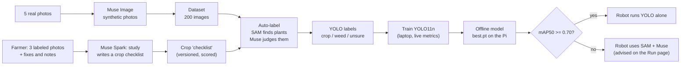
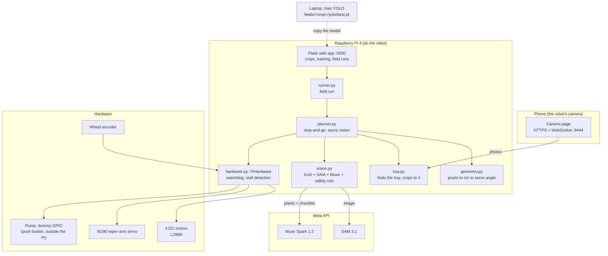
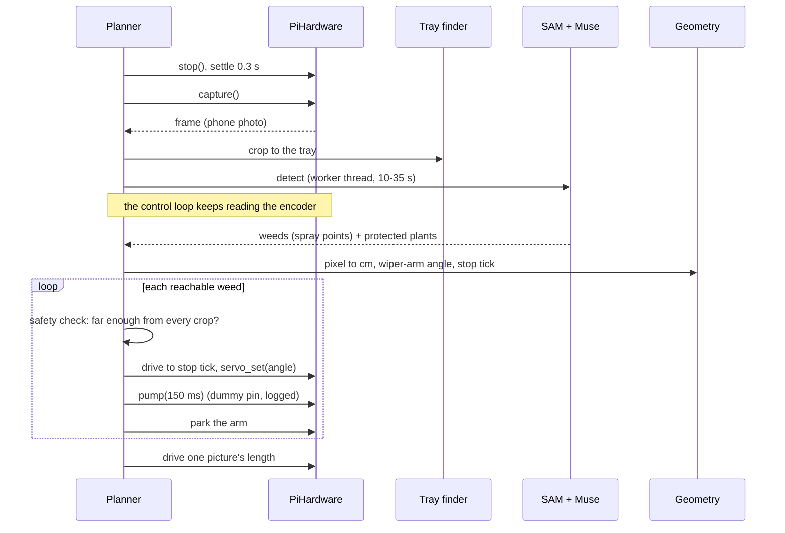
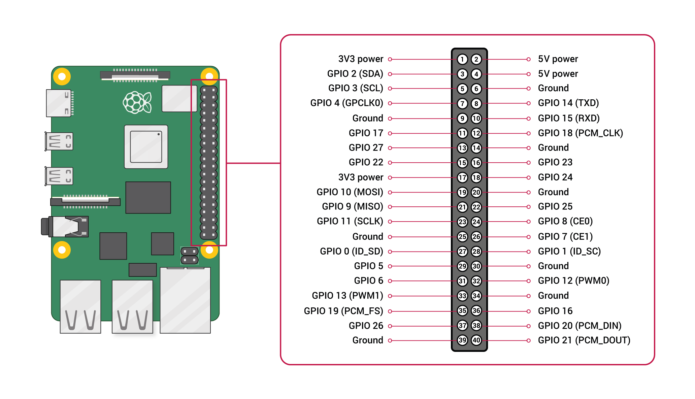

# OpenWeeder

**A low-cost precision weeding robot for small farms, taught by Meta AI.**
A small car drives along a row. A camera looks straight down. **SAM 3.1** outlines every plant, **Muse Spark** judges
which are weeds, and a servo **wiper arm** swings a nozzle across the row to spray **only the weeds**. A farmer teaches a
new crop with about ten photos. The big cloud models then teach a small offline detector, so the robot can work without
internet.

`Meta SAM 3.1` · `Muse Spark 1.3` · `Muse Image 1.0` · `YOLO11n` · `Raspberry Pi 4` · `Python 3.11` · `Flask`

> **Status in one paragraph.** The whole pipeline works end to end and is tested: teach a crop, generate and label a
> dataset, train YOLO, plan the spray geometry, and drive the real hardware stop-and-go on a Raspberry Pi 4 with a safety
> watchdog. **The offline YOLO model is not accurate enough yet** (it finds 7-12% of weeds); **SAM + Muse is**
> (45-61% of weeds found on real photos, 0-1 crop hits), but it is slow (about 35 s per picture). We report both, with the
> measurements, in [Results](#results-honest-numbers). The pump is a dummy GPIO output for now (switched by a push button
> outside the Pi), so the robot logs exactly where it would spray.

## Contents

| Judging criterion | Where to look |
|---|---|
| **Impact** | [The problem](#the-problem) · [Results](#results-honest-numbers) (liquid saved) |
| **Use of Meta AI tooling** | [How we use Meta AI](#how-we-use-meta-ai) · [AI teaches AI](#the-core-idea-big-ai-teaches-a-small-model) |
| **Demo** | [Run it](#run-it) · [The platform](#the-platform-what-you-click) · [Simulator](#the-simulator-the-robot-before-the-robot) |
| **Technical depth** | [Architecture](#architecture) · [Geometry](#geometry-from-pixels-to-a-spray) · [Motion, encoder and the wiper arm](#motion-encoder-and-the-wiper-arm-the-measured-robot) · [Safety](#safety-by-design) · [Measured latency](#measured-latency) |

---

## The problem

Smallholder farms weed by hand or spray whole fields. Broadcast spraying wastes herbicide, harms the crop and soil, and
costs money. Weeding by hand is slow and hard on the back. A robot that sprays only the weeds needs to know **which plant is
a weed on THIS farm**, and every farm grows something different. Training a custom detector for each crop normally needs
a lot of labeled photos.

OpenWeeder's answer: **the farmer labels about three photos, and Meta's models do the rest.**

In our simulator (placeholder robot numbers) spraying only the detected weeds used about **7 ml instead of 101 ml**, 93%
less liquid than broadcasting the same dose over the row. See the caveats under [Results](#results-honest-numbers).

## How we use Meta AI

| Model | Role in OpenWeeder | Measured |
|---|---|---|
| **SAM 3.1** (`sam-3.1`) | Called with the prompt `"plant"`; returns a mask and box for every plant in the frame. Streamed through the Responses API and parsed with `meta-sam-parser`. | ~2.4 s at 480 px, ~12 s at full size; $0.0025/image |
| **Muse Spark 1.3** (`muse-spark-1.3`) | **Four jobs:** (1) *study*: reads the farmer's labeled photos and writes a **checklist** of how this crop differs from its weeds; (2) *judge*: calls each plant crop / weed / mixed / unsure with a confidence, using that checklist (JSON-schema output, batches of 8); (3) *review/revise*: critiques its own mistakes on unlabeled photos and rewrites the checklist, keeping a version only if it scores at least as well on the farmer's photos; (4) *prompts*: writes SAM prompts for the experiments below. | ~18-30 s per picture; ~$0.02 |
| **Muse Image 1.0** (`muse-image-1.0`) | **Synthetic dataset generation.** From a handful of the farmer's real photos it makes new photos with the *same tray, soil, light and phone quality* but different plants and weeds, so a detector has hundreds of images to learn from. | $0.01/image |

What we learned the hard way, from experiments rather than guesses (full list in [`PROJECT.md`](PROJECT.md)):

- **SAM cannot tell species.** A crop-description prompt returned either nothing or masks that also covered 86-96% of the
  weeds. We tested it again with a prompt written by Muse itself for the crop: SAM returned **zero crops** and the robot
  would have sprayed everything. So SAM only finds plants; **Muse decides crop vs weed.**
- **Touching plants come back as one object.** We never spray a whole object: the spray point comes from weed pixels kept
  15 px away from crop pixels.
- **Hints from a different photo make things worse.** Everything the judge sees (reference crops, the row) comes from the
  same field.
- **Long answers get cut off.** Batches of at most 8 plants, JSON schema, retry once, and on failure every plant in the
  batch is **protected**.
- **When unsure, protect.** Spraying a crop is the worst mistake; leaving a weed is a minor one.

## The core idea: big AI teaches a small model

The cloud models are accurate but slow (about 35 s per picture) and need internet. A robot in a field needs fast, offline
detection. So the platform runs a **teacher-student loop**:



The page that starts a field run **measures the student against the teacher and advises**: below mAP50 0.70 it recommends
running SAM + Muse instead of the small model. Today that is the honest answer for our crop.

## Architecture



**One rule makes simulation trustworthy:** everything that touches hardware goes through one interface,
`Hardware` (`drive`, `stop`, `ticks`, `capture`, `servo_set`, `pump`, `laser`, `now`, `sleep`).
`planner.py` talks to the world **only** through it. The simulator runs the planner on `FakeHardware`; the robot runs the
**same planner** on `PiHardware`. There is no separate "demo code path".

### One stop of the robot



## Geometry: from pixels to a spray

All positions are centimetres: `x` forward, `y` to the left, origin under the arm's pivot. The camera looks straight down
(29 cm above the soil on the real robot; the simulator's default is 25 cm).

- **Two ground planes.** The crop sits on a raised ridge and weeds often grow in the furrow 8 cm lower. The same pixel is a
  different place on each plane, so the code places a point on the ridge, picks the plane, and places it again.
- **Camera calibration from an A4 sheet.** One photo of a flat A4 gives a homography (and the camera's tilt) with no special
  equipment (`tools/calibrate_a4.py`).
- **The wiper arm.** An arm of length `L` carries the nozzle on an arc. To hit a weed `y` cm to the side the arm swings to
  `phi = asin(y / L)` and the car must stop `L cos(phi)` **before** the weed: `stop tick = weed tick - L cos(phi)`.
- **Validated independently** against OpenCV (`projectPoints`/`solvePnP`): a straight-down grid is recovered to
  **0.006 cm** maximum error, and a camera tilted 5 degrees to **0.007 cm** with the A4 homography (0.4 cm without it).

## Motion, encoder and the wiper arm (the measured robot)

The simulator started with guessed numbers. These are the **measured** ones from the real robot (`calib/robot.json`,
`calib/hardware.json`), and everything below is computed from them:

| Quantity | Value | How it is known |
|---|---|---|
| Arm length `L` (pivot to nozzle) | **8.0 cm** | measured |
| Camera ahead of the arm pivot `D` | **16.5 cm** | measured |
| Camera height above the soil | **29 cm** | measured |
| Camera field of view | **20.8 degrees** (a phone camera, narrow) | measured |
| One picture covers | **10.7 x 8.0 cm** of ground, **0.08 mm per pixel** | computed: `2 h tan(fov/2)` |
| The camera sees ground | **12.5 to 20.5 cm** ahead of the pivot | computed: `D +/- half a picture` |
| Wet radius of the spray | 0.75 cm (+ 0.25 cm safety margin) | measured |
| Arm reach to the side | **+/- 7.9 cm** (`L sin 80 degrees`) | computed from the servo limit |

### The wiper ("wing") arm

A conventional pan-tilt nozzle needs two servos and a lot of trigonometry. We use **one SG90 servo that swings an 8 cm arm
like a windshield wiper** across the row. The arm sweeps an **arc of radius `L` ahead of the pivot**, so a point is reachable
only if it is on that arc. The planner turns "weed at `(x, y)`" into the two things the hardware can do:

```
arm angle      phi  = asin(y / L)                  (the servo goes to 90 + trim + phi)
stop the car   x_stop = x_weed - L * cos(phi)      (the pivot must be L cos(phi) BEHIND the weed)
```

```
            weed (x, y)
               *
   arm tip -> /|      <- the nozzle moves on this arc, radius L = 8 cm
             / |y
   pivot -> o--+------> driving direction (+x)
        stop here: x_weed - L cos(phi)
```

Worked example: a weed 4 cm to the side gives `phi = 30 degrees`; the car stops `8 cos 30 = 6.9 cm` before it. At the nozzle,
**1 degree of servo = 0.14 cm**, so even a 5-degree error stays inside the 0.75 cm wet radius. The SG90 turns 60 degrees in
0.1 s, so the swing costs almost nothing, and the planner waits exactly that travel time, no more.

Why an arm on an arc instead of a gantry: it is one cheap servo, there is nothing to jam, and the **geometry stays a closed
form**, so the planner can plan the whole row exactly and the simulator can score it. The price is that the car must do the
forward-and-back work: the **encoder is the other half of the aim**.

### The encoder and motion control

Forward and back is controlled by the wheel encoder, not by time.

- **Sensor:** a single-channel slot encoder (20 slots, 65 mm wheel, so about **1.02 cm per tick**; the exact `cm_per_tick` is
  measured on the rails with `tools/measure_ticks.py`). The pin has a **100 microsecond glitch filter**, so electrical noise is
  not counted as distance.
- **One channel cannot give direction**, so each tick counts in the direction last commanded, even while the car coasts after
  `stop()`. The planner knows this and stops `speed x coast time` early.
- **Speed loop:** the L298N drives the front and rear axles; a **50 Hz PI loop** with a feed-forward term holds the commanded
  speed against friction and battery sag, with a minimum duty (35%) below which the motors would stall and a ramp (120% per
  second) so the car never slams. Maximum speed is 8 cm/s; the demo speed is 3 cm/s.
- **Active braking:** both bridge inputs high for 0.3 s, then released.
- **Stall detection:** if the motors are driven and the encoder counts nothing for 3 s, the motors stop and the run reports
  *why*. The same mechanism **finds the end of the tray**: when the car presses the wall, the planner records the wall's tick
  and treats that picture as the last one.
- **Precision is honest, not magical:** one tick is about 1 cm and the wet radius is 0.75 cm, so a +/-1 tick stop error is the
  same size as the spray. That is why the planner settles 0.3 s after every stop, re-checks the **real** landing point against
  every crop before each spray, and keeps a safety margin.

### Stop-and-go, one picture at a time (`planner.run_stepwise`)

The camera sees a tiny 10.7 x 8.0 cm window, and the cloud AI takes 10-35 s per picture, so the robot moves like a surveyor:

1. **Stop**, settle, take a picture; **crop it to the tray** (`tray.py` finds the two walls, so anything outside the field can
   never be sprayed).
2. **Detect** (SAM + Muse, or YOLO) in a **worker thread**: the control loop keeps reading the encoder, so detection time never
   freezes the motors.
3. **Spray what is reachable:** for every weed, drive forward or back to its stop tick, swing the arm, pulse the pump, park the
   arm. A weed near the front edge **waits for the next picture**, because what grows just beyond it (a crop?) must be seen
   first.
4. **Advance** one picture's length and repeat, until the tray ends.

Because the camera looks 12.5-20.5 cm ahead of the pivot and the arm reaches only 8 cm, **every weed in a picture is outside
the arm's reach until the car drives up to it**. The planner is built around that: it does not guess, it moves the pivot to the
exact tick where the weed lies on the arc.

## Safety by design

Spraying a crop is the worst possible mistake. Every rule below exists because the opposite failed or could fail.

1. **Spray only a sure weed.** A plant is sprayed only when Muse calls it a weed at confidence >= 0.85 (the farmer can move
   this between 0.50 and 0.99 on the Results page). Crop, mixed and unsure are always protected.
2. **A veto after detection.** A spray whose centre falls inside any detected crop or unsure plant (grown by a margin) is
   removed.
3. **A second check at the real landing point.** Before every spray the planner takes the **actual** encoder position plus
   the arm angle and refuses if it is closer to a protected zone than the wet radius + margin (`skipped: near crop`).
4. **Scoring cannot be fooled.** In the simulator `CROP_HITS` is judged by where the nozzle **physically** was (true car
   position, real servo angle every 20 ms), not where the plan said. With the safety check turned off the same run hits a
   crop, so a zero is not vacuous.
5. **Hardware watchdog.** If nothing calls the interface for 2 s while driving, the motors stop, the pump pin goes low and
   the arm parks. If the encoder sees no movement for 3 s while the motors are driven, the motors stop (a stuck wheel).
6. **Hard limits.** Max speed 8 cm/s, pump pulse at most 500 ms, servo angles outside 10-170 degrees refused.
7. **The red button cuts pump and laser power in hardware.** Software never depends on it and never fights it.
8. **The pump is a dummy GPIO output** in this phase, so a bug cannot spray anything. The log and video show exactly where it
   would have.

## Results (honest numbers)

We keep numbers separate by how trustworthy they are. Synthetic images and AI labels are **not** ground truth; the only real
truth is the farmer's own labels on real photos.

### On the farmer's real photos (crop: molokhia, 3 labeled photos, 44 weeds, 12 crops)

| Detector | Weeds found | Crop hits | Latency / picture | Cost / picture |
|---|---|---|---|---|
| **SAM + Muse** (the pipeline) | **45-61%** (three runs) | **0-1** | **33-35 s** | ~$0.02 |
| SAM with a crop prompt written by Muse | 48% | **10** (rejected: SAM returned no crops, so it sprayed everything) | 6 s | ~$0.005 |
| YOLO11n (200 synthetic images, 960 px) | **7-12%** (safe setting) | 0 | n/a (not measured on the Pi) | free |

Read this carefully: three runs of the same photos gave 45-61% found and 0-1 crop hits, because Muse is not perfectly
repeatable. The checklist was learned from these same three photos, so the SAM + Muse numbers are an **upper bound**.

### The YOLO model, scored on the AI's labels (40 held-out test images)

| Class | Precision | Recall | mAP50 |
|---|---|---|---|
| crop | 0.64 | 0.88 | **0.85** |
| weed | 0.35 | 0.33 | 0.26 |
| unsure | 0.31 | 0.27 | 0.21 |

Crops are detected well and never sprayed. Weed detection is weak: the weed labels are tiny seedlings and thin grass blades,
the AI's labels are noisy, and 200 images is small. We say so on the page and advise SAM + Muse. Fixing the labels and the
dataset is the next step.

### In the simulator (field `tomato-3`, 73 cm strip, placeholder robot numbers, cached vision)

| Run | Weeds sprayed | Crop hits | Liquid vs broadcast | Time |
|---|---|---|---|---|
| two passes, stop-and-spray, 3 cm/s | 24/40 | **0** | 7.2 ml vs 100.7 ml | 94 s |
| two passes, continuous, 3 cm/s | 24/40 | **0** | 7.2 ml vs 100.7 ml | 78 s |
| two passes, stop-and-spray, 5 cm/s | 23/40 | **0** | 6.9 ml vs 100.7 ml | 63 s |
| one pass, real time, camera 40 cm ahead | 25/40 | **0** | 7.5 ml vs 100.7 ml | 45 s |

These use placeholder robot values (arm length, flow, latencies) and the vision was taught from the same photos, so they are
optimistic. The mechanics (timing, arm, landing) are not affected by that. Details and the reasons for every miss are in
[`PROJECT.md`](PROJECT.md).

### Measured latency

SAM 3.1 takes one still image per request (no video endpoint), so we measured a stream of frames (`tools/sam_video_latency.py`):

| Frame size | First answer | Whole answer (median) | Plants found |
|---|---|---|---|
| 1376x1824 (593 KB) | 2.5 s | **12.5 s** | 12 |
| 724x960 | 1.5 s | **4.0 s** | 12 |
| 483x640 | 1.5 s | **2.9 s** | 11 |
| 362x480 | 1.7 s | **2.4 s** | 11 |
| 4 frames at once (480 px) | | 4.7 s for all 4 = **0.85 fps** | |

It is **not real-time video**, which is why the robot works **stop-and-go**, and why the plan is to train the small offline
model. Resolution is the biggest lever: sending 480 px instead of full size cut the time five-fold with almost the same plants
found. The Muse judge, not SAM, is the bottleneck (18-30 s of the 35 s).

## The platform (what you click)

`python tools/app.py` serves the app on port 5000 (open it from a phone on the same Wi-Fi):

| Page | What it does |
|---|---|
| **Crops** | Every crop workspace and its learning status. |
| **New crop** | The guided flow: photo guide -> upload ~10 photos -> label 3 (tap each plant) -> the AI labels the rest -> the farmer **fixes** mistakes and **adds notes** -> re-run -> confirm. Each round Muse rewrites its checklist from the fixes; a new version is kept only if it scores at least as well on the labeled photos (leave-one-out), and an honest score is reported only on photos the farmer reviewed. |
| **Train model** | Collect a dataset (the robot records 2 images per second, or import images) -> **Auto label** (SAM + Muse) -> **Train YOLO** (up to 30 epochs, live per-epoch metrics) -> test-set results with the AI's label next to YOLO's prediction. |
| **Fields / New field** | A field is the real ground; it picks which trained crop's model to use. |
| **Run on the field** | Pick a crop and a detector. Advises SAM + Muse when the model's mAP50 is below 0.70, shows the measured accuracy and a time-and-cost estimate for the row, starts and stops the robot, and plays the recorded videos. |

A field run saves an **H.264 video** with every picture's detections drawn (crop green, weed red, unsure grey, the tray's walls
blue), the event log (every drive, stop, capture, servo move and pump pulse with its encoder tick), and a JSON summary.

## The simulator: the robot before the robot

`tools/sim.py` stitches a field's photos into one long strip with the farmer's labels as ground truth, runs the **real
planner** on a simulated robot (position, encoder, a servo that takes time to turn, a pump log, latencies for settling,
spraying, the camera and the AI), then **scores** it: weeds sprayed and missed, crop hits (physical), sprays on nothing,
percentage of weed area covered, liquid used vs broadcasting. It writes a video with the camera window, a top-down view of the
car, arm and splashes, and live counters.

```bash
python tools/sim.py --field tomato-3                  # two passes: map, drive back, stop-and-spray
python tools/sim.py --field tomato-3 --continuous     # spray without stopping
python tools/sim.py --field tomato-3 --realtime --camera-cm 40   # one pass, fast detector
python tools/sim.py --field tomato-3 --lifecycle      # data columns -> offline training -> real column
```

One simulator finding shaped the hardware: the wiper nozzle sits `L cos(phi)` **ahead** of its pivot, so for a one-pass run the
camera must see a weed before the pivot is that far behind it, about arm length + half a frame. With the simulator's default
25 cm arm that means a camera ~40 cm ahead (with it 12 cm ahead every central weed is seen too late, so the tested plan there is
**two passes**). The real robot's 8 cm arm and 16.5 cm camera offset satisfy the condition, and it works stop-and-go.

## Hardware

Raspberry Pi 4, an L298N driving 4 DC motors with an encoder-based speed loop, a single-channel slot encoder on a wheel, an 8 cm
SG90 servo wiper arm (hardware-timed PWM through pigpio), a pump (a **dummy GPIO / LED for now**), and an Android or iPhone as the camera (a web page on the phone
sends photos over HTTPS + WebSocket). Every pin and limit lives in [`calib/hardware.json`](calib/hardware.json)
(documented in [`calib/HARDWARE.md`](calib/HARDWARE.md)); nothing else hard-codes a pin.



## Run it

```bash
# Raspberry Pi
python3.11 -m venv .venv && source .venv/bin/activate
pip install -r requirements-pi.txt
cp .env.example .env          # put your META_API_KEY in .env (never commit it)
sudo systemctl enable --now pigpiod
./run.sh                      # open http://<pi-ip>:5000
```

Open the camera link or QR code from the Train page on your phone (same Wi-Fi). On a laptop (no motors) the app, the
simulator and the dry-run tests work the same way: `python tools/app.py`. For details see [`START_HERE.md`](START_HERE.md) and
[`docs/`](docs/) (`ROBOT_BRIEF.md`, `PRD_ROBOT_INTEGRATION.md`, `ROADMAP.html`).

```bash
pip install -r requirements-dev.txt
python -m pytest -q           # 127 test functions; they run dry, no motors move
```

## Repository map

| Path | What |
|---|---|
| `tools/app.py`, `templates/`, `static/` | Flask web app |
| `tools/vision.py`, `tools/sam_client.py` | the AI pipeline: ExG mask, SAM 3.1, Muse Spark judge, safety rule |
| `tools/setup.py` | per-crop learning: study, review/revise rounds, versioned checklist, honest score |
| `tools/geometry.py` | pixels <-> cm <-> servo angle <-> encoder tick; wiper-arm maths; A4 calibration |
| `tools/planner.py` | the brain: two-pass, stop-and-go (`run_stepwise`), continuous, one-pass real time, async vision |
| `tools/hardware.py` | `Hardware` interface, `FakeHardware` (simulator), `PiHardware` (motors, encoder, servo, pump, watchdog) |
| `tools/runner.py`, `tools/video_rec.py` | field runs: detection, spraying, H.264 videos |
| `tools/tray.py`, `tools/phone_cam.py` | tray detection and the phone-camera server |
| `tools/trainer.py` | dataset, auto label, YOLO training, the spray rule and scoring |
| `tools/make_dataset.py`, `tools/gen_image.py` | Muse Image dataset generator (edit mode keeps the farmer's tray and look) |
| `tools/sim.py` | the simulator and its scoring |
| `tools/compare_detectors.py`, `tools/sam_video_latency.py` | measured accuracy and latency |
| `calib/` | pins, limits and measured robot dimensions |
| `tests/` | `pytest`: planner, geometry, hardware, trainer, tray, runner, UI |
| `PROJECT.md` | findings, lessons and the geometry/simulator write-up |

## Limitations and what is next

We would rather state these than have you find them:

- **The offline YOLO model finds only 7-12% of weeds.** The weed labels are noisy (the AI's), the weeds are tiny, and 200
  synthetic images is small. Next: tighter weed labels, a size filter for tiny seedlings, more data, and tuning the spray
  threshold on a held-out calibration set.
- **SAM + Muse is slow** (about 35 s per picture) and costs about 2 cents each. A 100 m row at one picture per 19 cm is about
  500 pictures. It is right for a demo and for labeling, not for covering a farm.
- **Muse is not perfectly repeatable**, so one run is not a result. We report ranges.
- **Real-photo evidence is small** (3 labeled photos) and the checklist was learned from them.
- **The pump is a dummy output.** The robot logs and records where it would spray; real liquid is a push button.
- **Some robot numbers are still to be measured**: arm length, camera position and field of view are measured, but `cm_per_tick`
  (nominal 1.02 cm from the wheel and slot count), the pump flow and the latencies are still placeholders until measured on the
  rails (`tools/measure_ticks.py`, `tools/calibrate_a4.py`).
- **One crop so far** (molokhia on a tray) plus tomato and carrot test fields.

## Hackathon

Built for the **Meta Global AI Developer Hackathon** (Indie track). The intelligence is Meta's, through the API: SAM 3.1
finds the plants, Muse Spark judges and learns, Muse Image makes the training data. The small offline detector that those
models teach is YOLO11n from Ultralytics (AGPL-licensed: check the terms before commercial use).
